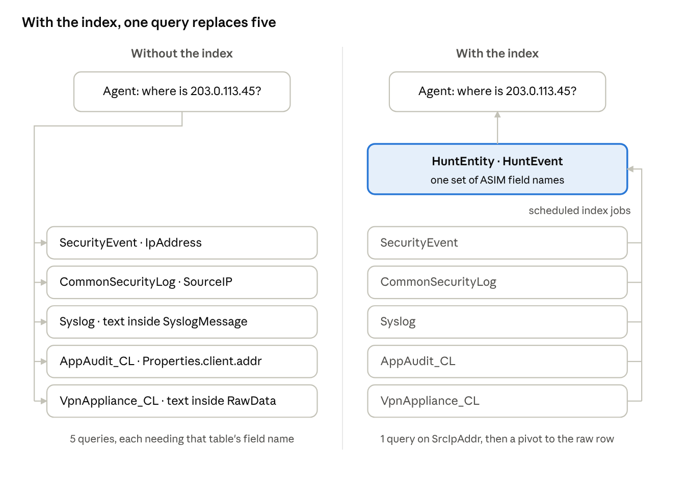
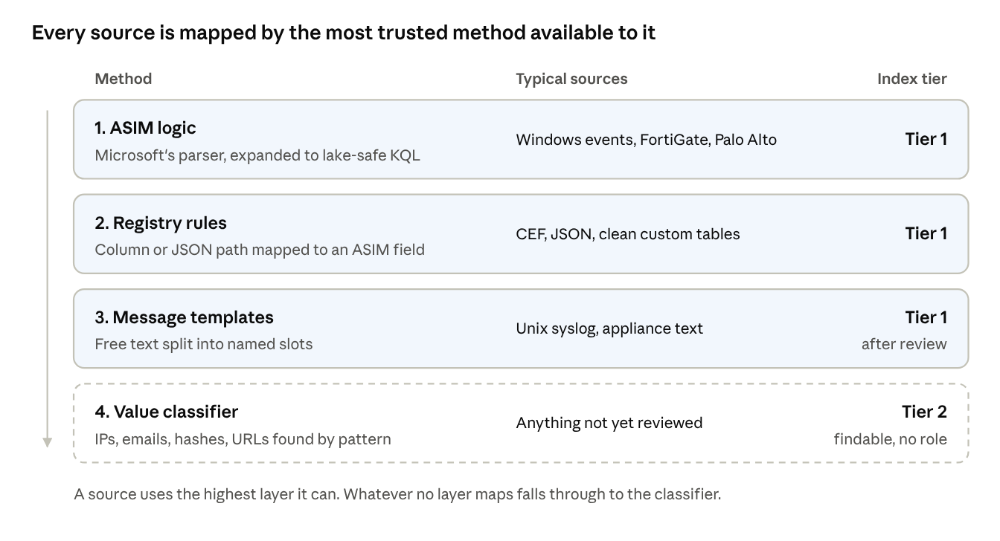
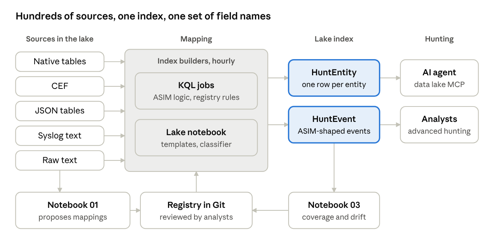
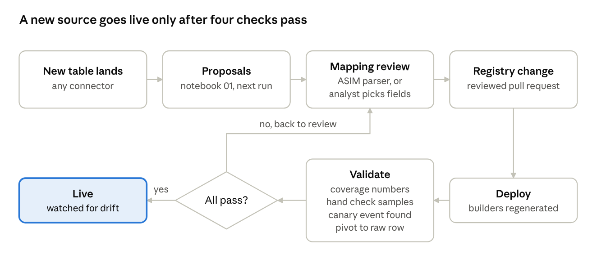

# Hunting across hundreds of log sources in the Sentinel data lake

David Broggy, October 2026

Microsoft Sentinel data lake makes it affordable to keep hundreds of third-party log sources for a year or more. Hunting across them is harder. Each source names the same things differently: an IP address is `SourceIP` in one table, `src` in another, and buried inside free text in a third.

ASIM (the Advanced Security Information Model) is Microsoft's answer to this in the analytics tier. It does not carry over to the lake as it is, for three reasons:

- ASIM parsers are stored KQL functions, and lake KQL does not run stored functions.
- Each parser is written for one product's table and message format. A source without a parser gets no normalization.
- Parsers run at query time. Over a year of lake data, that cost is paid on every hunt.

This matters more now that hunts start from an AI agent. The Sentinel data lake MCP server lets an agent write and run KQL against the lake. An agent asked "where has this IP shown up?" needs one field name to search, not three hundred.

## Normalize once, into an index

My approach is to do the normalization work once, ahead of time, and store the result in the lake. Scheduled lake jobs read every source table and write two tables:

- HuntEntity holds one row per entity, per hour, per source and role (an IP, a user, a host, a URL, a hash), with its type, its role (source, destination, actor, target, device), a lowercase join value, a count, first and last seen times, and a few sample record keys. Rolling up by the hour keeps the table small enough to search a full year cheaply.
- HuntEvent holds one row per event, with ASIM field names such as `SrcIpAddr`, `TargetUsername` and `EventResult`, for sources mapped well enough to trust.

Every HuntEvent row keeps a pointer back to the original record, and every HuntEntity row names the source table and hour. The agent searches the index, then pivots to the raw rows when it needs the full detail.

How to read it: on the left, the agent must query each table with that table's own field name, and two of the five hide the IP in free text. On the right, scheduled jobs (the line on the far right) feed every source into the index ahead of time, and the agent asks a single question of it.

## Four ways a source gets mapped

No single method covers hundreds of sources, so the index uses four, in order of trust. Each source uses the best one available to it, and each index row records which one produced it.

1. ASIM logic. Where Microsoft ships an ASIM parser, its KQL is expanded into a lake-safe query (no stored functions) and runs as a job. This gives the same fields ASIM would.
2. Registry rules. For structured sources with no parser (CEF, JSON, clean custom tables), a short mapping in a Git registry says which column or JSON path holds which ASIM field.
3. Message templates. For free text such as Unix syslog, a notebook groups messages into templates by masking the variable parts. An analyst names the slots once, for example "Failed password for `<user>` from `<ip>`".
4. Value classifier. Anything left over is scanned for values that look like IPs, emails, hashes or URLs. These rows are findable but carry no role, so they are marked as a lower tier.

How to read it: top to bottom is most trusted to least. The middle column shows the kinds of sources each method suits; the right column is the tier the index records, which the agent uses to weigh a result. The dashed band catches whatever the other three miss.

The result is that every source is searchable on day one, and the mapping gets better as sources are reviewed.

## The architecture

Everything runs inside the Sentinel data lake. There are no new data connectors, DCRs or ingestion changes: the index is built from data already there.

The index builders are of two kinds. KQL jobs handle sources that already have structure, through ASIM logic and registry rules. Lake notebooks handle the rest. A lake notebook is Python for Spark (PySpark), written as a Jupyter notebook in Visual Studio Code with the Microsoft Sentinel extension, that reads lake tables and writes its results back to the lake. KQL jobs and notebooks can both run on a schedule, so once a source is approved nobody runs anything by hand.

Three scheduled notebooks do the work that would otherwise be manual:

- Notebook 01 runs daily. It scans every lake table, profiles each field (how often it is filled and what its values look like) and proposes ASIM names, roles and message templates for an analyst to review.
- Notebook 02 runs hourly. It indexes free-text and not-yet-reviewed sources through message templates and the value classifier, into the same two tables the KQL jobs write.
- Notebook 03 runs daily. It measures each source's coverage and flags any source whose extraction rate drops, which usually means the vendor changed its log format.

Analysts approve mappings and check results. Finding new fields, building the index and catching format changes all run on a schedule.

How to read it: the top row runs left to right. Source tables of every shape feed the index builders, which write the two index tables that the agent and analysts query. Every index row leads back to its raw records, so a hit is one pivot from the full event. The bottom row is the control loop: notebook 01 reads the sources and proposes mappings, analysts approve them in the registry, the registry generates the builders, and notebook 03 measures each source's coverage and flags the ones that drift back for review.

## One question, five sources

The example below uses sample data from five sources with very different shapes: Windows security events, FortiGate firewall logs over CEF, Linux sshd syslog, a JSON audit table from an in-house app, and a VPN appliance that writes raw key=value text. The agent asks one question: where has `203.0.113.45` appeared?

| Source | How it was mapped | Role | Result |
| --- | --- | --- | --- |
| Windows SecurityEvent | ASIM logic | Source | Failure |
| FortiGate (CEF) | ASIM logic | Source | Failure (deny) |
| Linux sshd (Syslog) | Message templates | Source | Failure, 2 events |
| App audit (JSON) | Registry rules | Source | Failure |
| VPN appliance (raw text) | Classifier, then templates after review | Source | Failure |

One query over the index found the address in all five, each time labelled as the source, with a failed or denied result. Asked for the same user's sign-ins, the index returns four failures from that address within about a minute, then successes from an internal address 16 minutes later. Without the index, the agent would need five different queries and would have to know each table's field names.

## Adding a new source

Once the index is running, a new log source needs a mapping review, not a new pipeline. The new table is searchable through the classifier from its first indexing run, before anyone has looked at it.

How to read it: the top row runs left to right, then the flow turns down at the registry and runs right to left. Review starts from the parser if Microsoft ships one, otherwise from the fields and templates notebook 01 proposes. After deployment, four checks run: coverage numbers in the coverage table, a hand check of sample rows, a known test event found through the agent, and a pivot back to the raw row. Any failure sends the source back to review.

## Cost at 1 TB a day

At 1 TB a day of lake ingestion, the index costs about $1,000 to $1,900 a month. That covers the hourly KQL jobs, the three notebooks and one year of storage for both index tables. Most of the range comes from how long notebook 02 runs each hour. The figures use Microsoft's published Sentinel data lake prices in US dollars for East US. The full calculation and its assumptions will be in the GitHub repository.

## Limits

- The index covers common hunting fields: IPs, users, hosts, URLs, hashes, results and event types. Fields that only matter to one product stay in the raw table, one pivot away.
- Index freshness follows the job schedule, hourly in this design. Real-time detection stays in the analytics tier.
- Lake KQL jobs have tenant limits on count and concurrency, so sources are batched into shared jobs rather than one job per source.
- The design has been deployed and run in a test tenant with the Sentinel data lake onboarded. Behaviour at production volume still needs confirming, including notebook run times and how the job limits apply at 1 TB a day.

The point of the design is that the cost of normalization is paid once per source, not once per hunt, and that an AI agent gets one consistent set of field names across every log source in the lake.
