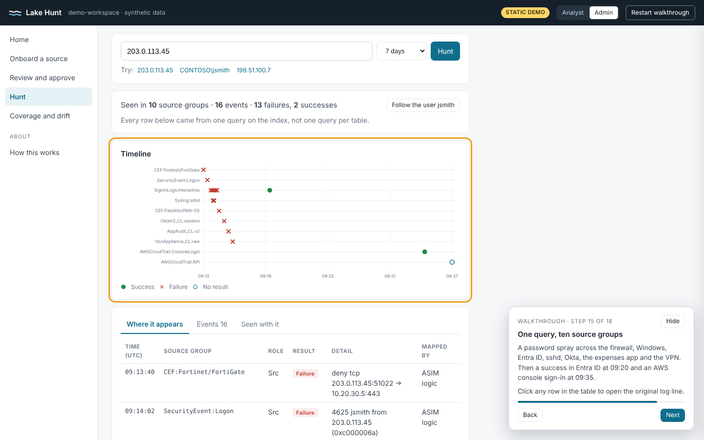

# Lake Hunt walkthrough demo

A static, guided walkthrough of the daily operations workflow for a hunt index in the Microsoft Sentinel data lake. One HTML file, no server, no build step.

Open `index.html` in a browser. With GitHub Pages enabled for this repository (Settings, Pages, deploy from the `main` branch, root folder) it is served at https://broglock.github.io/sentinel-data-lake-normalization/demo/.

## What the walkthrough covers

The walkthrough has 18 steps. Use Next and Back on the walkthrough card, or hide it and click through the menu on your own.

1. Daily schedule: notebook 01 (inventory and template mining) daily, KQL jobs and notebook 02 hourly, notebook 03 (coverage and drift) daily.
2. Notebook 01 runs and proposes two changes: a new table, `BadgeReader_CL`, and a new message template for `VpnAppliance_CL` after a firmware change.
3. Home: the queue of work that needs a person.
4. Field review for the new table: accept the high-confidence fields, decide the medium one, skip the badge number.
5. Preview, submit, and approval by an Admin.
6. The generated lake job (an hourly rollup into `HuntEntity`), deployment, and four validation checks.
7. Coverage and drift, and fixing the VPN template.
8. A threat hunt on `203.0.113.45` across ten source groups, then a pivot to the user `jsmith`, where the newly onboarded badge reader shows him in the office before the "remote" sign-in.

## Data

All data is synthetic: documentation IP ranges (192.0.2.0/24, 198.51.100.0/24, 203.0.113.0/24), private 10.x addresses and contoso.com names. The page makes no network calls.

## Related

- Design, solution kit and cost model: the rest of this repository, starting with the [README](../README.md)
- Blog post: https://simple-security.ca
