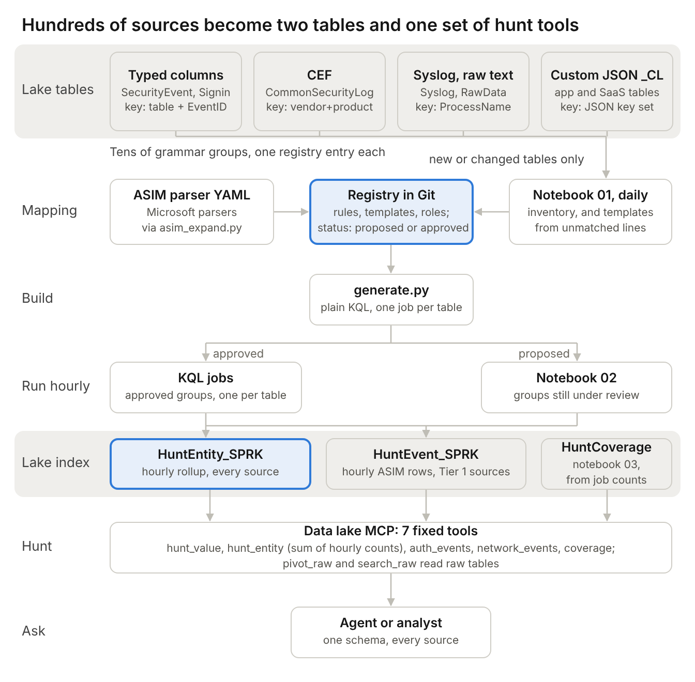
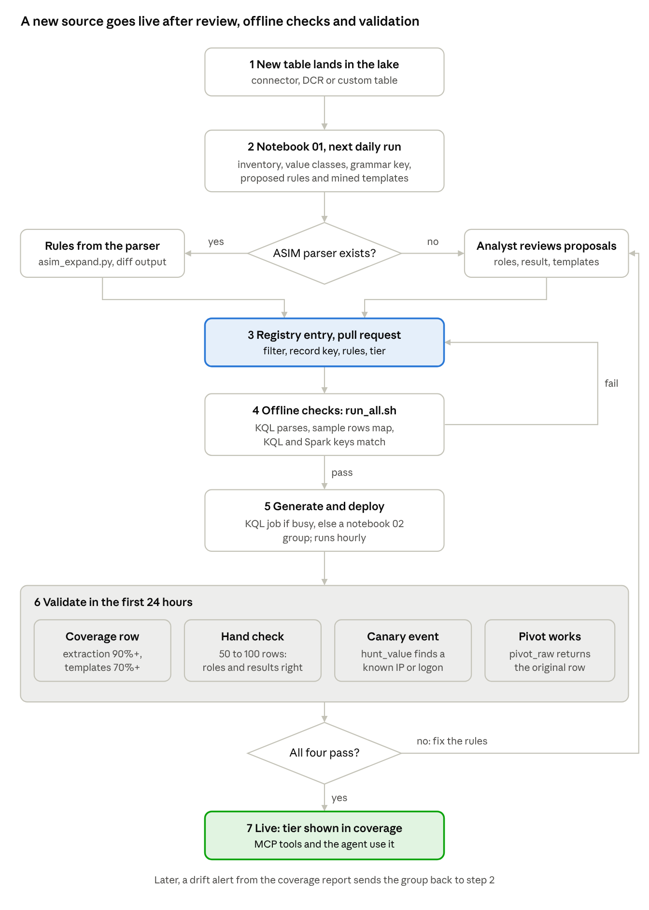

# ASIM-style hunting on the Sentinel data lake: questions and solution

18 October 2026 · David Broggy

## Summary

No single mechanism resolves most non-ASIM fields. What works across every log source in the lake is a layered build: reuse Microsoft's ASIM parser logic where it exists, map everything else through one role-aware registry per grammar group, mine templates for raw text, and fall back to a value classifier. All of it writes to two lake tables with ASIM field names, and the data lake MCP queries those tables through a small set of fixed tools.

The goal is high recall on the five entities people hunt for most (IP address, host, user, file hash, URL or domain) across all sources, with an explicit role and a mapping tier on every row. Roles (source or target) and outcomes (success or failure) stay partial for sources without a parser or a reviewed template, and the design records that instead of hiding it.

Changes from the earlier infographic design, based on this round of research:

- A long entity table (one row per entity, source, role and hour, with a count) sits beside the wide event index. It scales to any source without adding columns, and it gives an agent one shape to query.
- Every mapping carries a role, with `Unknown` allowed, plus the layer that produced it.
- Outputs land in the lake tier (KQL job output to System tables with `_KQL`, or notebook output with `_SPRK`), not the analytics tier by default.
- Lake notebooks cannot install packages, so Drain3 is out. Template mining uses token masking in plain PySpark instead.
- The job budget is real: 100 enabled KQL jobs per tenant and 3 concurrent notebook jobs. Work is grouped by grammar, not by table.
- Custom Sentinel MCP tools (preview) can be saved from KQL queries with parameters, which gives the agent deterministic hunt tools.

## Architecture at a glance

How to read it: the diagram runs top to bottom. The grey band at the top is the lake tables, grouped by format, with the key that splits each table into grammar groups. Notebook 01 (right) reads only new or changed tables and approved groups whose lines stopped matching, and proposes fields and templates. The registry in the middle holds every rule with a status: proposed or approved. generate.py turns approved groups into one KQL job per source table; proposed groups go to notebook 02. Both engines write the second grey band: HuntEntity_SPRK (an hourly rollup of entity counts, plus the _stats job-count rows) and HuntEvent_SPRK (ASIM-shaped Tier 1 events). Notebook 03 builds HuntCoverage from the job counts without reading source tables. The MCP tools query only those tables and pivot back to the raw rows with the sampled record keys. Adding a source means adding registry entries, not new tables or DCRs.

## Five log sources, end to end

One attacker IP (`203.0.113.45`) and one user (`jsmith`) appear in five unrelated sources. After normalization in the lake, `hunt_value` finds the IP in all five and `auth_events` returns the user's logons with result and source IP. Full registry, generated KQL and the actual output rows: `solution-kit/examples/five-sources/` (`five_sources.yaml`, `kql_out/`, `output.md`).

| # | Source | Lake table and format | ASIM parser | How it is mapped in the lake | Tier |
| --- | --- | --- | --- | --- | --- |
| 1 | Windows sign-ins | `SecurityEvent`, typed columns | Yes (`_Im_Authentication_MicrosoftWindowsEvent`) | Registry rules matching the parser's output, `EventID` mapped to type and result | 1 |
| 2 | FortiGate traffic | `CommonSecurityLog`, CEF | Yes (`_Im_NetworkSession_FortinetFortiGate`) | Registry rules on CEF columns, `DeviceAction` through the result vocabulary | 1 |
| 3 | Linux sshd | `Syslog`, free text | Yes (`_Im_Authentication_Sshd`) | Two message templates covering the same messages as the parser | 1 |
| 4 | In-house expenses app | `AppAudit_CL`, JSON | No | Registry rules on JSON paths, proposed by notebook 01 and approved | 1 |
| 5 | VPN appliance | `VpnAppliance_CL`, raw key=value text | No | Value classifier only, until templates are reviewed | 2, then 1 |

hunt_value('203.0.113.45'):

| SourceTable | SourceGroup | Events | Roles | Tiers | Results |
| --- | --- | --- | --- | --- | --- |
| AppAudit_CL | AppAudit_CL:v2 | 1 | Src | 1 | Failure |
| CommonSecurityLog | CEF:Fortinet/Fortigate | 1 | Src | 1 | Failure |
| SecurityEvent | SecurityEvent:Logon | 1 | Src | 1 | Failure |
| Syslog | Syslog:sshd | 2 | Src | 1 | Failure |
| VpnAppliance_CL | VpnAppliance_CL:raw | 1 | Unknown | 2 | |

auth_events('CONTOSO\\jsmith'), after the VPN templates are approved:

| Time | SourceGroup | EventResult | User as logged | SrcIpAddr |
| --- | --- | --- | --- | --- |
| 09:14:02 | SecurityEvent:Logon | Failure | jsmith | 203.0.113.45 |
| 09:14:41 | Syslog:sshd | Failure | jsmith | 203.0.113.45 |
| 09:15:03 | AppAudit_CL:v2 | Failure | JSmith@contoso.com | 203.0.113.45 |
| 09:15:20 | VpnAppliance_CL:raw | Failure | jsmith | 203.0.113.45 |
| 09:31:40 | SecurityEvent:Logon | Success | jsmith | 10.20.30.40 |
| 09:33:09 | AppAudit_CL:v2 | Success | jsmith@contoso.com | 10.20.30.40 |
| 09:33:50 | VpnAppliance_CL:raw | Success | jsmith | 10.20.30.40 |

## The questions to ask

Eighteen questions decide whether ASIM-style hunting works on the lake. Seven are answered by current Microsoft documentation, six need a lab test, two need an answer from Microsoft, and three are design decisions this document makes. Question 3 matters most: if ASIM parsers run in Defender advanced hunting over lake-tier tables, much of the custom work shrinks.

| # | Question | What the research found | Status |
| --- | --- | --- | --- |
| 1 | Can ASIM parsers run in lake KQL or KQL jobs? | No. Lake KQL does not support out-of-the-box or custom functions, and KQL jobs state that user-defined functions aren't supported. Every ASIM parser is a function. | Answered |
| 2 | Do query-scoped `let` functions (lambdas) run in lake KQL? | The KQL jobs page shows scalar `let` statements working. Whether `let f = (x:string) {…}` counts as a user-defined function there is not stated. | Test in lab |
| 3 | Do ASIM parsers run in Defender advanced hunting against lake-tier tables? | Advanced hunting can now query lake-tier tables interactively and lists Sentinel functions in its Functions tab. Nothing says whether ASIM parsers resolve over lake-only tables. | Test in lab |
| 4 | Can custom Sentinel MCP tools (saved queries) query lake tables? | Custom tools (preview) are saved from advanced hunting queries with `{Parameter}` placeholders. The page mentions both advanced hunting and lake KQL but does not say which tiers a tool reaches. | Test in lab |
| 5 | Does `search_tables` find custom `_CL` tables and job output tables? | Not documented. It covers standard and content hub tables, and lists some `_CL` tables as unsupported. | Test in lab |
| 6 | Where can a normalized index live? | KQL jobs write to the analytics tier (`_KQL_CL`) or to lake System tables (`_KQL`, preview). Notebooks write lake (`_SPRK`) or analytics (`_SPRK_CL`). | Answered |
| 7 | What is the job budget? | KQL jobs: 100 enabled per tenant, 1-hour timeout, one output table. Concurrency is 5 on one Learn page and 3 on the limits page. Notebook jobs: 8-hour timeout, 3 concurrent, more are queued. | Answered |
| 8 | Can lake notebooks use Drain3 or other packages? | No. Only Azure Synapse libraries 3.4 and the Sentinel Provider library; no pip or custom libraries. | Answered |
| 9 | Can DCR transforms do ASIM-style mapping? | Partly. Supported: `extend`, `project`, `project-rename`, `where`, `parse` (10 columns), `extract`, `extract_all`, `parse_json`, `split`, `replace`, `parse_cef_dictionary`, scalar `let` functions. No `summarize` or `join`. | Answered |
| 10 | Do transforms apply to lake-only tables, and can split output ASIM-shaped rows? | Split routes non-matching rows to a lake table with an `_SPLT` suffix. Field-level mapping through split, and transforms on lake-only tables, are not documented. | Test in lab |
| 11 | Can native ASim tables (`ASimNetworkSessionLogs` and nine others) be set to the lake tier? | Not documented. The ingest-time normalization page does not mention the lake tier. | Ask Microsoft |
| 12 | Which ASIM fields carry the common entities? | Device: `Dvc`/`Src`/`Dst` with `Hostname`, `Domain`, `DomainType`, `FQDN`, `IpAddr`. User: `Actor`/`Target` or `Src`/`Dst` with `Username`, `UsernameType` (UPN, Windows, DN, Simple), `UserId`, `UserIdType` (SID, UID, AADID, OktaId, AWSId, PUID). Result: `EventResult` is Success, Partial, Failure or NA. | Answered |
| 13 | Where can Microsoft's existing mappings be reused from? | The Azure-Sentinel GitHub repo holds each parser as YAML under `Parsers/ASim<Schema>/Parsers/`, with the KQL in `ParserQuery`. Confirm the structure before building the sync. | Test in lab |
| 14 | For a source with no parser, how is a field's role decided? | Values alone cannot tell source from destination. Use column-name tokens plus analyst review, and store `Unknown` when neither settles it. | Design decision |
| 15 | How is `EventResult` derived from vendor words? | ASIM derives it from the vendor's result or reason field. Without a parser that needs a per-grammar vocabulary, reviewed once. | Design decision |
| 16 | How does a hunt pivot from the index back to the raw row? | `_ItemId` and other system columns are overwritten when jobs and notebooks write output, and `TimeGenerated` is overwritten if older than two days. Keep the source time and a source record key in your own columns. | Answered |
| 17 | How is coverage proven per source? | Nothing in the product reports it. Build a coverage report (section 9). | Design decision |
| 18 | Is ASIM in the lake on the roadmap? | Nothing in What's new from July 2025 to September 2026. Ask through the MVP channel, together with questions 3, 10 and 11. | Ask Microsoft |

## Platform facts that shape the design

The lake gives you four places to run normalization, each with a hard limit that decides what it is used for.

| Engine | What it can do | Limits that matter | Used here for |
| --- | --- | --- | --- |
| Lake KQL (interactive, MCP `query_lake`) | All operators except `externaldata()`, `adx()`, `arg()`, `ingestion_time()`; no functions | 500,000 rows or 64 MB per result; 4-minute timeout (8 minutes on one page); 30 or 45 queries per minute depending on the page | Hunting the index tables, pivots back to raw |
| KQL jobs | Same KQL, scheduled; append to an existing table or create one | 100 enabled jobs per tenant; 3 to 5 concurrent, rejected not queued when over; 1-hour timeout; one output table | Index builds for high-volume grammar groups with ASIM logic inlined |
| Notebook jobs (PySpark) | Read any lake table, write lake (`_SPRK`) or analytics (`_SPRK_CL`) | 8-hour timeout; 3 concurrent, the rest queued; no pip or custom libraries | Long-tail index builds, template mining, discovery, backfill, coverage report |
| DCR transforms at ingest | Row-by-row KQL subset, `parse_cef_dictionary`, scalar `let` functions | No `summarize` or `join`; `parse` limited to 10 columns; lake-only table support not documented | Optional: ASIM columns for the top few sources by volume |

Two platform behaviours change how the index is written. Output columns named `TenantId`, `Type`, `_ItemId` and other system names are overwritten, so source identifiers go in your own columns. `TimeGenerated` is overwritten when older than two days, so the original event time goes in `EventStartTime`.

## Target model: two lake tables

Every source, parsed or not, writes into the same two tables. `HuntEntity_SPRK` is an hourly rollup: one row per hour, source group, entity value, role and result, with a count. It covers all sources. `HuntEvent_SPRK` holds ASIM-shaped rows for sources mapped at Tier 1, including Tier 1 templates on text sources, rolled up the same way: one row per hour and unique combination of the mapped fields, with a count. Names use the notebook lake suffix; KQL jobs writing to System tables produce `_KQL` instead.

Inside each job the rules first produce one row per entity occurrence. The rollup then groups those rows by hour. At 1 TB/day this keeps HuntEntity at a few percent of the occurrence count instead of roughly the size of the raw data (see `notes/cost-model-1tb-day.md`).

### HuntEntity: hourly rollup

| Column | Type | Content |
| --- | --- | --- |
| Hour | datetime | Start of the hour the events fall in |
| FirstSeen, LastSeen | datetime | Earliest and latest source event time in the row (kept because `TimeGenerated` can be overwritten) |
| SourceTable | string | Table the events came from |
| SourceGroup | string | Grammar group, for example `Syslog:sshd` or `CEF:Palo Alto Networks/PAN-OS` |
| EventVendor, EventProduct | string | ASIM vendor and product names where known |
| EventSchema, EventType, EventResult | string | ASIM values where mapped; empty otherwise |
| EntityType | string | `ip`, `host`, `user`, `hash`, `url`, `domain`, `email`, `process`, `file`, or `_stats` (below) |
| Role | string | `Src`, `Dst`, `Actor`, `Target`, `Dvc` or `Unknown` |
| Value | string | One form of the value as it appeared (the smallest, so reruns give the same row) |
| ValueNorm | string | Normalized value used for matching (section 6) |
| ValueType | string | ASIM type: `UPN`, `Windows`, `Simple`, `SID`, `AADID`, `IPv4`, `IPv6`, `SHA256`, `MD5`, `FQDN`, `Hostname` |
| MappingLayer | string | `asim`, `asimtable`, `registry`, `template` or `classifier` |
| MappingTier | int | 1 = role and result known, 2 = entity known, 3 = search only |
| Count | long | Number of occurrences in the hour |
| SampleKeys | dynamic | Up to three `SourceRecordKey` values, first in sort order, for the pivot back to raw (section 8) |

Each job also writes job-count rows into HuntEntity, because a KQL job has one output table. These rows have `EntityType = "_stats"`, one of three roles and the number in `Count`: `RowsRead` (raw rows the group read in the hour), `RowsWithEntity` (raw rows that produced at least one entity) and `RowsTemplateMatched` (raw rows a template matched, text groups only). The docs call these rows HuntJobStats. Notebook 03 builds the coverage report from them without reading any source table, and the hunt tools skip them.

### HuntEvent: ASIM-shaped rows for Tier 1 sources, hourly rollup

Each job first builds one row per event with the ASIM columns below, then groups them by hour and every mapped column except the source port, which differs on almost every connection. Repeated sign-ins and sessions with the same user, addresses, port, action and result become one row. The row carries `Hour`, `FirstSeen`, `LastSeen`, `Count` and up to three `SampleKeys`, as in HuntEntity.

| Group | Columns |
| --- | --- |
| Rollup | Hour, FirstSeen, LastSeen, Count, SampleKeys |
| Event | SourceTable, SourceGroup, EventVendor, EventProduct, EventSchema, EventType, EventResult, EventResultDetails, EventSeverity |
| Network | SrcIpAddr, DstIpAddr, DstPortNumber, NetworkProtocol, DvcAction (SrcPortNumber is mapped but not kept) |
| Device | SrcHostname, DstHostname, DvcHostname, DvcIpAddr, DvcDomain |
| User | ActorUsername, ActorUsernameType, ActorUserId, ActorUserIdType, TargetUsername, TargetUsernameType |
| Web and DNS | Url, DstDomain, HttpUserAgent, DnsQuery |
| File and process | FileName, FileSHA256, FileMD5, ActingProcessName, TargetProcessName, TargetProcessCommandLine |

The agent's default question ("where did this value appear?") hits `HuntEntity`. Questions that need ASIM semantics ("failed logons by this user") hit `HuntEvent` or the Tier 1 rows of `HuntEntity`, and say so through `SourceGroup`.

## Mapping layers and precedence

Each grammar group is routed to the first layer that can map it, and the value classifier then sweeps every row for values no layer mapped. A field mapped by a higher layer is never overwritten by a lower one.

Diagram (in the Claude Doc): Grammar group splits three ways: ASIM logic or ASim table (Tier 1, to HuntEvent), registry rules (structured and JSON fields), template registry (syslog and raw text). Registry and template rows pass through the value classifier to HuntEntity; Tier 1 rows also reach HuntEvent; HuntEvent entities also land in HuntEntity.

| Layer | Source of the mapping | Maintained by | Effort per new source |
| --- | --- | --- | --- |
| ASIM logic | `ParserQuery` from Microsoft's parser YAML, synced from GitHub | Microsoft; your sync job | None once synced |
| ASim tables | DCR transform at ingest | You | One DCR; only for the top sources by volume |
| Registry rules | Column name or JSON path to ASIM field, role, value type | Analyst review of proposed rules | Minutes per grammar group, proposals generated |
| Templates | Message template with slots mapped to ASIM fields | Analyst review of mined templates | Minutes per template, ranked by volume |
| Classifier | Regex and checks on values | You, once | None |

Reusing Microsoft's parsers is not a copy and paste. Source parsers are functions with parameters, and most call helper functions of their own: `_ASIM_ResolveSrcFQDN` and its Dst and Dvc forms, `_ASIM_GetUsernameType`, the `_ASIM_Lookup*` tables, and `_ASIM_GetDisabledParsers`, which reads a watchlist. None of these run on the lake either. The kit's `asim_expand.py` turns parameters into `let` statements, inlines the helpers it knows, and lists any call left over; a parser with calls left is mapped through registry rules instead.

## Role, result and value rules

Three rule sets turn a mapped value into something an agent can trust: a role from the field name, a result from the vendor's words, and a normalized value from the value itself. The generator proposes all three; an analyst approves each grammar group once.

### Role from the field name

| Tokens in the name | Role | Notes |
| --- | --- | --- |
| src, source, client, orig, from, caller (for addresses) | Src | `callerip` is Src; `caller` alone is Actor |
| dst, dest, destination, server, resp, to | Dst | `to` only when the name has another network token |
| user, username, account, actor, initiator, subject, principal, login, caller | Actor | For user entities only |
| target, member, object, affected, recipient | Target | For user entities only |
| host, hostname, computer, device, dvc, observer, reporter, sensor | Dvc | Only when the field is not also Src or Dst |
| ip, address, addr, remote, peer, local | Unknown | Reviewed per grammar group |

CEF is the exception: `SourceIP`, `SourceHostName`, `SourceUserName` map to Src; `DestinationIP`, `DestinationHostName`, `DestinationUserName` to Dst; `DeviceName` to Dvc; `RequestURL` to Url. `DeviceCustomString1` to `6` are mapped by the value of their matching label column, per vendor.

### Result from the vendor's words

| Vendor value (lowercased) | EventResult |
| --- | --- |
| success, succeeded, allow, allowed, accept, accepted, permit, permitted, pass, ok, HTTP 1xx to 3xx | Success |
| fail, failed, failure, deny, denied, block, blocked, drop, dropped, reject, rejected, error, invalid, HTTP 4xx and 5xx | Failure |
| partial, partially | Partial |
| anything else, or no result field | NA |

For network sessions a block is `EventResult = Failure` with the vendor word kept in `DvcAction`.

### Values: normalize for matching, keep the original

| Entity | ValueNorm | ValueType | False positives to block |
| --- | --- | --- | --- |
| IP | Address without port or brackets; must parse as IPv4 or IPv6 | IPv4, IPv6 | Version strings (`v10.2.0.1`), OIDs, timestamps |
| User | Lowercase account name without domain | UPN, Windows, DN, Simple, SID, AADID | `-`, `N/A`, `SYSTEM` noise; SIDs stay uppercase and unsplit |
| Host | Lowercase short host name | FQDN, Hostname | IP addresses written in a host field |
| Hash | Lowercase hex | MD5 (32), SHA1 (40), SHA256 (64) by length | GUIDs without dashes when the field name has no hash token |
| URL | Refanged, scheme and host lowercase, path kept | URL | Relative paths with no host |
| Domain | Lowercase, trailing dot removed | FQDN | File names with dots |

The join key is deliberately loose for users and hosts; the agent checks `Value` and `ValueType` before it asserts that two rows are the same person. The generated KQL for these rules is in `solution-kit/generator/generate.py` (NORMALIZE_TAIL).

## Build pipeline and job budget

1. Inventory (daily notebook job, change-driven): reads only new tables, tables whose column list or JSON key set changed since the last run, and the lines the index jobs counted as unmatched. Approved, high-confidence groups are skipped. Typed columns, JSON keys and key=value keys with type, fill rate and value class. Output `FieldInventory_SPRK`.
2. Group: `ProcessName` for Syslog, `DeviceVendor` + `DeviceProduct` for CEF, a source tag or first token for raw `_CL` tables, a fingerprint of the sorted key list for JSON tables.
3. Propose: registry rules from synonyms, role tokens and value classes; templates by token masking. Proposals land as a pull request.
4. Review: an analyst approves or corrects each grammar group once.
5. Generate: KQL job queries for every approved group, including approved message templates, which are written as KQL `parse` or `extract`; a config for the notebook covering only unreviewed groups; MCP tool queries.
6. Run: KQL jobs and the notebook append to `HuntEvent` and `HuntEntity` each hour, aligned hour windows, 15-minute delay. Each run reads only the new hour; nothing already indexed is read again. Each job also writes its counts (rows read, rows with an entity, rows matching a template) to `HuntJobStats`.
7. Measure: a daily job builds the coverage report from `HuntJobStats`. It does not read source tables.

A source group moves through three states. Unreviewed: the notebook indexes it hourly through the value classifier (Tier 2). Approved: its mapping runs in a KQL job and the notebook no longer touches it. Drifting: the job counts show the match rate falling, notebook 01 reads the unmatched lines on its next run and proposes a fix. In steady state most volume runs in KQL jobs and the notebooks handle only new and changed sources.

| Work | Engine | Schedule | Count | Limit it stays inside |
| --- | --- | --- | --- | --- |
| Index build, top grammar groups | KQL jobs | Hourly, start minutes staggered | Up to about 40 | 100 enabled per tenant; 3 to 5 concurrent, rejected when over |
| Index build, unreviewed groups only | Notebook job | Hourly | 1 | 3 concurrent notebook jobs, 8-hour timeout |
| Inventory and template mining, new and changed sources only | Notebook job | Daily | 1 | Same |
| Coverage report from `HuntJobStats` | Notebook or KQL job | Daily | 1 | Same |
| Backfill of history | Notebook job | On demand | 1 at a time | Same |

## Data lake MCP integration

| Tool | Parameters | Queries | Answers |
| --- | --- | --- | --- |
| hunt_value | Value, LookbackDays | HuntEntity | Every source where a value appeared, with roles, tiers, first and last seen |
| hunt_entity | EntityType, Value, Role, LookbackDays | HuntEntity | Same, limited to one entity type and optionally one role |
| auth_events | User, Result, LookbackDays | HuntEntity user rows with a Logon event type | Logons with result, Tier 1 sources only |
| network_events | Ip, LookbackDays | HuntEvent where EventSchema is NetworkSession | Sessions with direction and action, Tier 1 sources only |
| pivot_raw | SourceTable, FirstSeen, LastSeen, Value | The raw table, through `table()` | The original rows behind an index row |
| search_raw | Text, Table, LookbackHours | One raw table with `where * has` | Literal matches the index missed |
| coverage | SourceGroup (optional) | Coverage report table | Tier, extraction rate and last run per source |

Queries and agent instructions: `solution-kit/mcp/tools.yaml`.

Agent instructions: start every hunt with hunt_value or hunt_entity; report how many sources matched at each tier; treat Role = Unknown as unknown; use auth_events or network_events only when a result or direction is needed and say only Tier 1 sources can answer; fetch originals with pivot_raw before quoting; run search_raw over the tables named by coverage before saying a value was not seen.

Each grammar group defines its `SourceRecordKey` in the registry (source event ID, or a SHA-256 of the event time formatted to milliseconds and the raw columns). HuntEntity and HuntEvent rows each cover up to an hour, so each carries up to three keys in `SampleKeys`. The generic `pivot_raw` tool filters the raw table to `FirstSeen` to `LastSeen` (one second either side) plus the entity value; with a group's key expression the app filters on the sampled keys instead and returns exactly those rows. Rows that share a sampled key came from the same event, which is how the timeline and "seen with it" views find other entities without per-event rows.

## Coverage, QA and drift

| Metric per grammar group | How it is computed | Action when it fails |
| --- | --- | --- |
| Tier | Highest tier its approved mappings reach | None; reported with every hunt |
| Extraction rate | Share of raw rows with at least one `HuntEntity` row | Under 90% for structured groups or a drop of 20 points against the 28-day average: review the group |
| Template match rate | Share of raw text rows matched by an approved template | Under 70%: mine and review the next templates |
| Unmapped high-fill fields | Fields filled in over 50% of rows with no rule | Generator proposes rules for review |
| Unknown role share | Share of entity rows with `Role = Unknown` | Over 30% on a Tier 1 group: role rules need review |
| Last run | Latest index write for the group | Raw rows but nothing indexed in the last day: job rejected or failed, or filters disagree |
| Hand-checked sample | 50 to 100 rows reviewed when a group is approved or changes | Any wrong role or result blocks Tier 1 |
| Canary events | Known logon, IP and hash generated on purpose, then hunted with `hunt_value` | Not found where expected: incident on the pipeline |

## Onboarding a new log source

How to read it: top to bottom. A new table lands in the lake, notebook 01 inventories it on its next daily run, then the path splits. With an ASIM parser, rules come from the parser through asim_expand.py; without one, an analyst reviews the proposed fields, roles and templates. Either way the result is a registry pull request, checked offline with run_all.sh (a failure loops back to the PR), then generated and deployed. Validation runs in the first 24 hours; if any of the four checks fails it goes back to analyst review, otherwise the group is live and notebook 03 watches it for drift.

| Check | How it runs | Pass condition |
|---|---|---|
| Coverage | HuntCoverage_SPRK row for the group | Extraction 90%+; template match 70%+ for text sources; status ok |
| Hand check | Sample 50 to 100 raw rows next to their index rows | Values, roles and results match by eye |
| Canary event | Generate a known event (test logon, test connection), then hunt_value on its IP or user | The event appears with the expected group, role and tier |
| Pivot | pivot_raw on the canary's SourceRecordKey | Returns exactly the original raw row |

## Lab tests, corrections and the solution kit

Offline checks pass (Kusto.Language parse and schema check; notebook logic on sample data with a fake provider). The design has since been deployed and run in a test tenant with the data lake onboarded; production-volume behaviour is still open. Lab tests: `solution-kit/tests/lab-test-plan.md`. Cost: `notes/cost-model-1tb-day.md`.

| Infographic | Current wording | Correction |
| --- | --- | --- |
| 4, 8, 9 | ASIM parser logic can be inlined into lake queries | True only after helper functions are inlined too; use `asim_expand.py` and fall back to registry rules |
| 9, 10 | Drain3 in a notebook does template mining | Lake notebooks cannot install packages; mining uses token masking in PySpark |
| 9 | Index table `HuntIndex_KQL_CL` | Analytics-tier name; lake options are `_KQL` (KQL job to System tables, preview) or `_SPRK` (notebook) |
| 10 | One KQL job per grammar group | Up to about 40 KQL jobs; every other group runs in one hourly notebook job |
| 2 | 30 queries per minute | Microsoft's pages say 30 or 45 per minute and a 4- or 8-minute timeout |

### Sources

- https://learn.microsoft.com/en-us/azure/sentinel/datalake/kql-queries
- https://learn.microsoft.com/en-us/azure/sentinel/datalake/kql-troubleshoot
- https://learn.microsoft.com/en-us/azure/sentinel/datalake/kql-jobs
- https://learn.microsoft.com/en-us/azure/sentinel/datalake/sentinel-lake-service-limits
- https://learn.microsoft.com/en-us/azure/sentinel/datalake/sentinel-provider-class-reference
- https://learn.microsoft.com/en-us/azure/sentinel/datalake/notebook-jobs
- https://learn.microsoft.com/en-us/azure/sentinel/datalake/sentinel-mcp-data-exploration-tool
- https://learn.microsoft.com/en-us/azure/sentinel/datalake/sentinel-mcp-tools-overview
- https://learn.microsoft.com/en-us/azure/sentinel/datalake/sentinel-mcp-create-custom-tool
- https://learn.microsoft.com/en-us/defender-xdr/advanced-hunting-microsoft-defender
- https://learn.microsoft.com/en-us/azure/sentinel/transformation-filter-split
- https://learn.microsoft.com/en-us/azure/azure-monitor/data-collection/data-collection-transformations-kql
- https://learn.microsoft.com/en-us/azure/sentinel/normalization-ingest-time
- https://learn.microsoft.com/en-us/azure/sentinel/normalization-common-fields
- https://learn.microsoft.com/en-us/azure/sentinel/normalization-entity-user
- https://learn.microsoft.com/en-us/azure/sentinel/normalization-entity-device
- https://learn.microsoft.com/en-us/azure/sentinel/normalization-functions
- https://learn.microsoft.com/en-us/azure/sentinel/normalization-develop-parsers
- https://learn.microsoft.com/en-us/azure/sentinel/whats-new
- https://infernux.no/blog/microsoft-sentinel-september-2026/
- https://www.precursorsecurity.com/blog/sentinel-data-lake-threat-hunting
