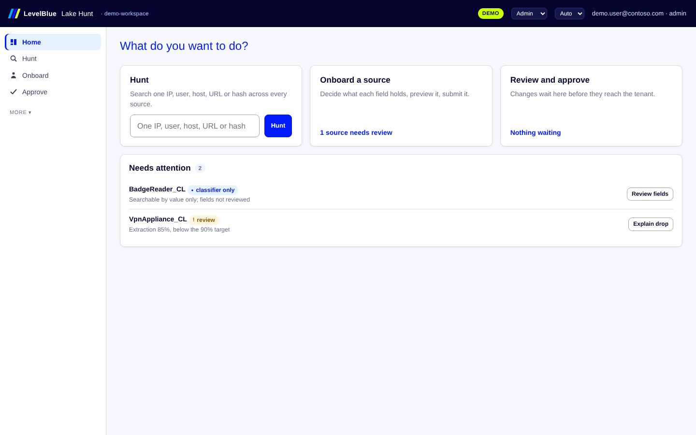
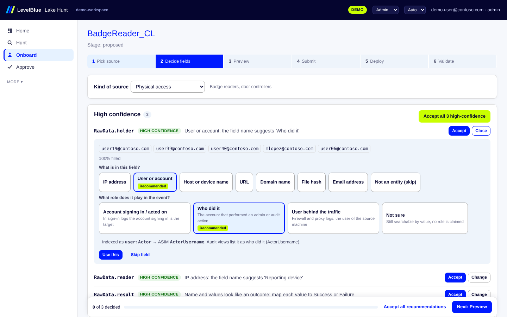
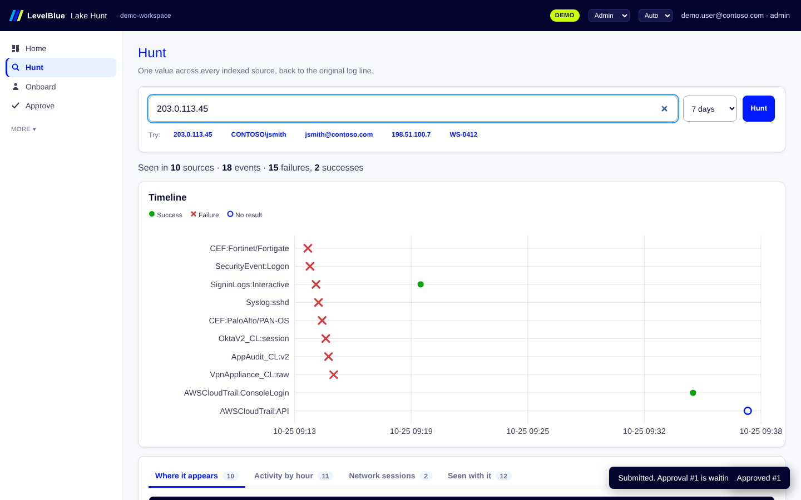

# LevelBlue Lake Hunt

Lake Hunt normalizes the log sources in a Microsoft Sentinel data lake into one hunt index with ASIM field names. It runs as one container: a web UI, a REST API and an MCP server for AI agents. It covers the whole workflow:

- plan connectors from the Content hub catalog
- decide field mappings for unknown tables with guided choices
- approve changes
- generate and deploy the lake jobs
- validate each source
- watch coverage
- hunt across every source with one query

Version 1.0.0. Demo mode runs anywhere with no Azure access. Live mode runs in the customer's subscription with a managed identity.



## What it does

| Screen | Purpose |
|---|---|
| Home | The three jobs (Hunt, Onboard a source, Review and approve) with live counts, and one Needs attention list: sources to review, sources below the 90% extraction target, checks waiting on a person, pending approvals. |
| Hunt | One search for an IP, a user in any format, a host, URL or hash. A one-line summary, a timeline per source, and tabs for where it appears, activity by hour, sign-ins, network sessions and entities seen with it. Every row opens the original log line. A pasted list becomes pick-one chips. |
| Onboard | One flow per source: pick source → decide fields → preview → submit → deploy → validate. Fields are one-line rows with a recommendation; Change opens the plain-language choices. Generated YAML and KQL stay folded. |
| Approve | An inbox of pending changes. Each card says in plain words what the change does, with the preview numbers. Approve, or reject with a reason. Admins only. |
| More | Coverage (extraction per source and drift), Registry (versions, YAML export), Connectors (Content hub catalog and plans), Build and deploy (all jobs and the bundle), API and agents, Settings and audit, About. |

### Guided field decisions

The operator never starts from a blank form. For each field the review screen shows:

- A recommended choice and the reason, for example "User or account: the field name suggests 'Who did it'". A confidence badge reflects the value-class share and whether the name supports the role.
- The evidence: sample values, fill rate, and the share of values that look like an IP, UPN, hash and so on.
- The common alternatives in plain words. For an IP: *Source*, *Destination*, *Reporting device*, *Not sure (still searchable, no direction claimed)*. Users and hosts have their own lists. The ASIM field name follows from the choice; operators do not type ASIM names.
- The effect of the choice, for example "Sign-in views list it as the account signing in (TargetUsername)".
- Result fields as a value list with one-click Success, Failure or Ignore, pre-set from the vocabulary.
- Template placeholders with dropdowns, and the suggested outcome from the message wording ("Failed password" suggests Failure).
- Source-type presets (sign-in log, firewall, web proxy, audit, physical access, other) that set sensible defaults. For example, the account in a sign-in log is the target.
- **Accept all high-confidence** and **Accept all recommendations** shortcuts, with a progress bar.
- A live preview on sample rows: extraction and template match against the targets, entity counts by type and role, raw rows next to the index rows they produce, and the generated YAML and lake KQL.



## Run the demo locally

```
pip install -r requirements.txt
uvicorn app.main:app --port 8080
```

Open http://localhost:8080.

**Demo data.** The data is synthetic and de-identified: documentation IP ranges and contoso.com names. It covers ten sources in nine tables:

| Source | Table |
|---|---|
| Windows sign-ins | SecurityEvent |
| Entra ID | SigninLogs |
| FortiGate and Palo Alto over CEF | CommonSecurityLog |
| Linux sshd | Syslog |
| AWS CloudTrail | AWSCloudTrail |
| Okta | OktaV2_CL |
| A JSON app audit table | AppAudit_CL |
| A raw key=value VPN appliance | VpnAppliance_CL |
| A badge reader that nobody has reviewed yet | BadgeReader_CL |

**The planted incident.** A password spray from 203.0.113.45 reaches an Entra ID success for jsmith, then an AWS console sign-in from the same IP, then a large outbound session from jsmith's workstation. Onboard the badge reader to see jsmith badge into the office minutes before the "remote" sign-in.

**Demo role.** The role selector in the top bar switches between Admin, Analyst and Viewer. It is shown in demo mode only.



## Demo video

`docs/demo/lakehunt-demo.mp4` (about 3 minutes) opens with the architecture (the daily scan of every lake table that proposes new fields per table, approval, hourly index jobs, the daily coverage check), then walks through the three jobs for an admin audience: onboarding the badge reader as an Analyst, approving it as an Admin, deploying and validating it, then hunting the planted incident. `docs/demo/lakehunt-hunt.gif` is the Hunt chapter alone.

To re-record after a UI change (a fresh demo instance runs on port 8090; nothing else is touched):

```
pip install -r requirements-dev.txt
python -m playwright install chromium
python tools/record_demo.py --screenshots
```

## Deploy to a customer subscription

Requirements:

- Azure CLI, logged in with Owner (or Contributor plus User Access Administrator) on the subscription.
- Rights to create Entra ID app registrations.

```
cd deploy
./deploy.ps1 -ResourceGroup rg-lakehunt -Location canadacentral -Mode demo
./deploy.ps1 -ResourceGroup rg-lakehunt -Location canadacentral -Mode live `
  -WorkspaceResourceGroup rg-sentinel -WorkspaceName law-sentinel -WorkspaceId <workspace guid>
```

`deploy.sh` takes the same options on Linux and macOS. The script does the following:

1. Builds the image in a new Azure Container Registry.
2. Creates the app registration with three app roles (LakeHunt.Admin, LakeHunt.Analyst, LakeHunt.Viewer), the `api://<client id>` audience and an `access_as_user` scope.
3. Deploys `main.bicep`, which creates:
   - a user-assigned identity
   - Azure Files storage for the app database
   - a Container Apps environment
   - the app with Entra ID sign-in
   - role assignments on the Sentinel workspace resource group: Microsoft Sentinel Contributor and Log Analytics Contributor

After the script, two steps are manual:

1. Assign the app roles to users or groups under Enterprise applications.
2. Live mode only: give the managed identity read access to the data lake under Microsoft Defender XDR unified RBAC.

## Live mode: what calls what

| Action | Azure API | Status |
|---|---|---|
| List tables, plans, retention | ARM `workspaces/tables` (2023-01-01-preview) | Documented API |
| Create a custom table on Analytics, Basic or Lake (Auxiliary) | ARM `PUT workspaces/tables/{name}` | Documented API. Moving built-in tables to lake-only is a Defender portal step. |
| Content hub catalog and install | `contentProductPackages`, then an ARM deployment of `packagedContent` | Same method as the community automation scripts. Confirm in a lab. |
| Hunting, coverage, samples | Sentinel data lake KQL API, `POST https://api.securityplatform.microsoft.com/lake/kql/v2/rest/query` | Documented; the token scope is configurable (`LAKEHUNT_LAKE_SCOPE`) because the docs do not state it. Confirm in a lab. |
| Volume per table | Log Analytics query API, `Usage` table | Documented API |
| KQL jobs and notebook jobs | none | No public create API. The Deploy screen produces the queries, `jobs.json` and portal steps. |

The app never handles vendor credentials. Connector secrets are entered in the Defender portal. Every write to the tenant needs an Admin approval and is recorded in the audit log.

## API and agents

- REST: `/api/v1`, OpenAPI at `/api/docs`. Every screen uses it.
- MCP: `POST /mcp` (Streamable HTTP, JSON responses), with the same Entra token. There are 16 tools:
  - hunting: `hunt_value`, `hunt_entity`, `auth_events`, `network_events`, `timeline`, `related`, `pivot_raw`, `search_raw`, `coverage`
  - onboarding: `list_sources`, `propose_mapping`, `preview_mapping`, `save_draft_mapping`, `validate_source`, `explain_drift`, `plan_connector`

  Viewers get the read tools only.

Agents can draft and submit mappings. They cannot make anything live: approval stays with a person, and the hand check in validation needs a person.

## Checks run on this build

| Check | Result |
|---|---|
| `python -m pytest tests` | 50 tests: the API tests and the browser tests in tests/test_ui.py (Home, role-based navigation, Hunt, the full onboarding flow, Approve, validation) pass: engine rules, the onboarding flow, drift and noise exclusion, role enforcement, MCP, live provider requests against a mocked Azure, and every generated KQL job and MCP query parsed with Microsoft's Kusto.Language library |
| `python tests/parity_spark.py` | The in-app engine and the lake notebook (Spark) produce the same 8,951 HuntEntity rows (hourly rollup and `_stats` rows, counts and sample keys included) and the same 2,370 HuntEvent rows from the demo week |
| Bicep | `main.bicep` and `roles.bicep` compile with Bicep 0.48.1 |
| Deploy scripts | `deploy.ps1` parses with PowerShell 7.4; `deploy.sh` passes `bash -n` |

Nothing has been run against a real tenant yet. Before production, confirm these in a lab tenant:

- the data lake query scope and the managed identity's lake permission
- the Content hub install by ARM deployment
- `let` lambdas inside KQL jobs (used for expanded ASIM parsers)
- KQL job concurrency
- SQLite on Azure Files under load

`../solution-kit/tests/lab-test-plan.md` lists the rest.

## Layout

```
app/
  main.py            FastAPI app: UI, /api/v1, /mcp
  core.py            workflow services: registry, onboarding, proposals, preview, build, validation, approvals
  engine/            indexer (same rules as the lake jobs), miner, guide (decision cards), hunt, coverage
  providers/         demo.py (in memory) and azure.py (ARM, lake KQL API, Log Analytics)
  kit/               generator, ASIM expander, vocab, MCP tool queries, the three lake notebooks
  demo/              demo data and demo registry
  data/catalog.json  Content hub snapshot (refresh with tools/build_catalog.py)
  static/            web UI: index.html, styles.css and js/ (plain ES modules, no build step)
deploy/              main.bicep, roles.bicep, app-roles.json, deploy.ps1, deploy.sh
tests/               pytest suite, Kusto checker, Spark parity check
tools/               catalog builder, demo recorder
docs/screenshots/    screens from the demo
```

## Settings

All settings are environment variables. Bicep sets them.

| Variable | Meaning |
|---|---|
| `LAKEHUNT_MODE` | `demo` or `live` |
| `LAKEHUNT_AUTH` | `easyauth` behind Container Apps authentication; `none` for local demo only |
| `LAKEHUNT_DATA_DIR` | Where the app database lives (`/data`, an Azure Files share) |
| `LAKEHUNT_SUBSCRIPTION_ID`, `LAKEHUNT_RESOURCE_GROUP`, `LAKEHUNT_WORKSPACE_NAME`, `LAKEHUNT_WORKSPACE_ID`, `LAKEHUNT_WORKSPACE_LOCATION` | Target Sentinel workspace |
| `LAKEHUNT_LAKE_QUERY_URL`, `LAKEHUNT_LAKE_SCOPE`, `LAKEHUNT_TABLES_API`, `LAKEHUNT_CONTENT_API` | API endpoints and versions, overridable as the preview surfaces change |

To refresh the connector catalog:

```
git clone --depth 1 --filter=blob:none --sparse https://github.com/Azure/Azure-Sentinel.git
cd Azure-Sentinel
git sparse-checkout set --no-cone '/Solutions/*/Data/*.json' '/Solutions/*/Data Connectors/**/*.json' '/Parsers/ASim*/Parsers/*.yaml'
python tools/build_catalog.py <checkout> app/data/catalog.json
```
